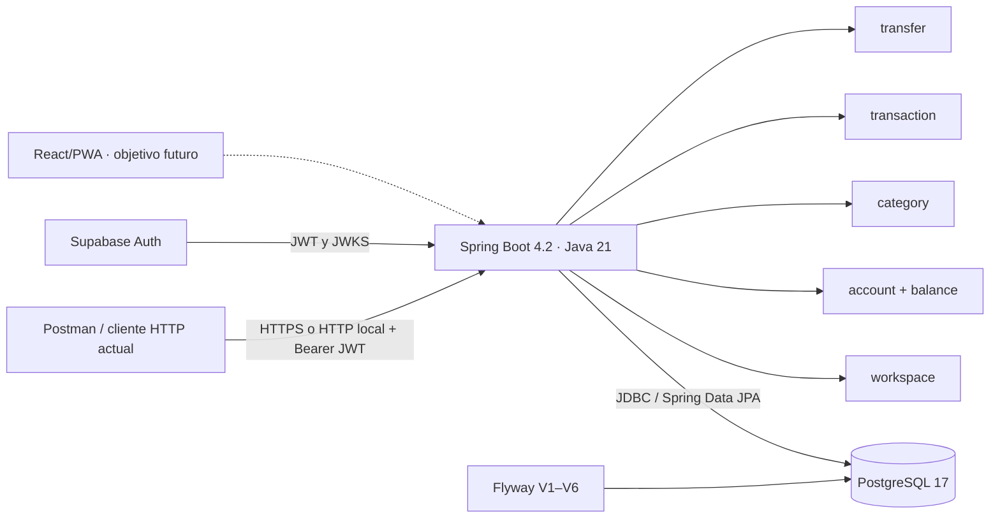
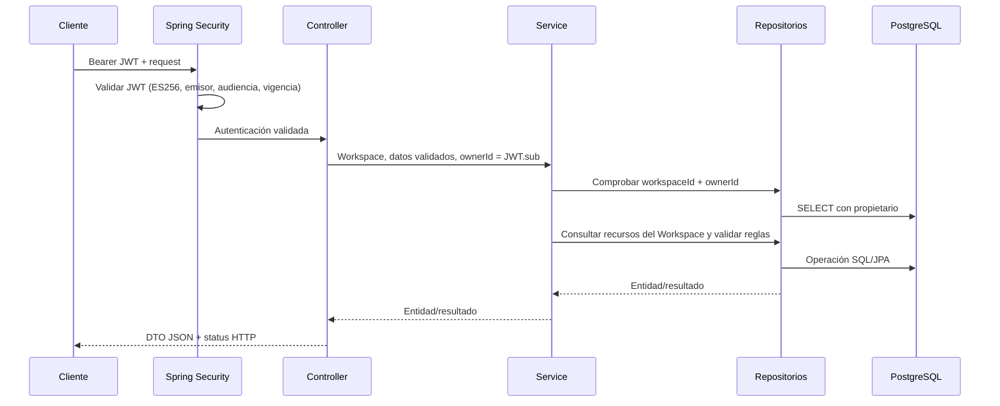

# Arquitectura técnica

## 1. Diagrama de contexto (implementado vs previsto)



El repositorio **observado** es un proyecto Maven en su raíz, no el monorepo `backend/` + `frontend/` descrito en los documentos iniciales. La PWA y el hosting Render/Vercel son **intenciones**, no componentes verificados.

## 2. Capas y paquetes

Base: `src/main/java/com/financesuite/zsurapp/`.

```text
ZsurappApplication.java
security/SecurityConfig.java
identity/controller/MeController.java
workspace/{controller,dto,entity,repository,service}
account/{controller,dto,entity,repository,service}
category/{controller,dto,entity,repository,service}
transaction/{controller,dto,entity,repository,service}
transfer/{controller,dto,entity,repository,service}
```

Los controllers reciben DTOs y JWT; los services autorizan y validan reglas; repositorios implementan persistencia; entidades modelan tablas con JPA. Cada dominio financiero valida la propiedad del Workspace antes de recuperar recursos por sus UUID.

### Módulos

- **identity:** `GET /api/v1/me` devuelve el UUID del usuario autenticado.
- **workspace:** representa un espacio `PERSONAL` o `BUSINESS`, de un propietario único.
- **account:** define cuenta, moneda, saldo inicial; submódulo de balance calcula resultado actual.
- **category:** catálogo por Workspace y tipo financiero.
- **transaction:** almacena ingreso/gasto categorizado (`INCOME`, `EXPENSE`).
- **transfer:** mueve dinero sin clasificarlo como ingreso o gasto; requiere cuentas distintas, mismo Workspace y moneda.

## 3. Flujo de una solicitud financiera



## 4. Modelo monetario y atomicidad

- Operaciones financieras con `BigDecimal` y `NUMERIC(19,4)`, importes positivos.
- Las fechas operativas son `Instant`/`TIMESTAMPTZ` (`occurred_at`); auditoría `created_at`, `updated_at`.
- Ingreso y gasto son registros en `transactions`, con `type` y `category_id` obligatorios.
- Transferencia es un único registro en `transfers` con `from_account_id` y `to_account_id`.
- La creación de transferencia usa `@Transactional`, de forma que el registro se confirma o revierte como unidad. **No existen dos asientos que requieran sincronizarse**, ni se modifica un `current_balance` persistido.
- Saldo derivado en la consulta:

```text
saldoActual = saldoInicial
            + SUM(transactions.amount WHERE type = INCOME)
            - SUM(transactions.amount WHERE type = EXPENSE)
            + SUM(transfers.amount WHERE to_account_id = cuenta)
            - SUM(transfers.amount WHERE from_account_id = cuenta)
```

Las cuatro sumas filtran simultáneamente por `workspace_id` y `account_id`. Esta fórmula no restringe saldos negativos y **no garantiza saldo suficiente frente a concurrencia**; ver riesgos.

## 5. Consistencia y autorización

`WorkspaceService.findByIdAndOwner` comprueba que `workspaces.id = workspaceId` y `owner_id = jwt.sub`. Después se buscan cuentas/categorías/movimientos dentro de ese espacio. No se confía en un `ownerId` recibido por JSON.

Las claves foráneas de V5/V6 son simples (`workspace_id`, `account_id`, `category_id` por separado). **La coherencia transespacio se garantiza principalmente en servicios Java, no mediante FKs compuestas**. Consultas SQL directas o nuevas features deben conservar esta regla o reforzarla en migraciones futuras.

## 6. Límites actuales

- No hay autorización por roles ni miembros de Workspace.
- No hay compensación/reversión o auditoría inmutable de operaciones históricas.
- No se implementaron idempotency keys ni bloqueo de saldos concurrentes.
- No se verificó frontend, cola de mensajes, OpenAPI/Swagger o CI en la rama inspeccionada.
- El `logging.level.org.springframework.security=DEBUG` del `application.properties` debe reducirse en producción.
