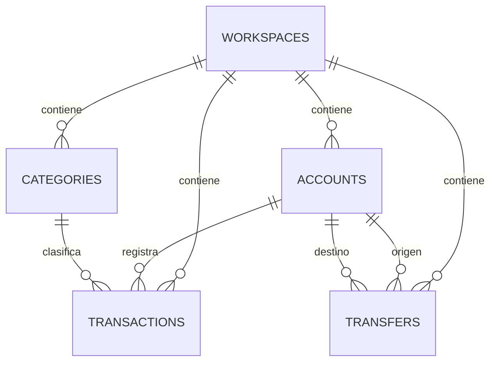

# Base de datos y migraciones Flyway

**Motor:** PostgreSQL 17, `finance_suite`, esquema `public`. **Fuente:** migraciones SQL V1–V6 inspeccionadas en rama `feat/transfers`.

## 1. Relaciones

`workspaces.owner_id` almacena un UUID de Supabase Auth; **no** es FK a una tabla local de usuarios. Las transferencias no crean registros en `transactions`.

## 2. Historial Flyway

| Versión | Archivo | Resultado |
| --- | --- | --- |
| V1 | `V1__init.sql` | `app_metadata` (configuración inicial) |
| V2 | `V2__create_workspaces.sql` | `workspaces`, índice `owner_id` |
| V3 | `V3__create_accounts.sql` | `accounts`, FK al workspace, tipos y moneda |
| V4 | `V4__create_categories.sql` | `categories`, unicidad por espacio, tipo y nombre |
| V5 | `V5__create_transactions.sql` | Ingresos/gastos, FK a espacio/cuenta/categoría |
| V6 | `V6__create_transfers.sql` | Transferencias con origen/destino y suma en saldos |

**Regla:** agregar V7, V8, etc. No reescribir migraciones ya aplicadas.

## 3. Esquema vigente resumido

### `app_metadata` — V1

`key VARCHAR(100) PRIMARY KEY`, `value VARCHAR(500) NOT NULL`, `created_at TIMESTAMPTZ NOT NULL DEFAULT CURRENT_TIMESTAMP`.

### `workspaces` — V2

| Columna | SQL | Restricción |
| --- | --- | --- |
| `id` | `UUID` | PK |
| `name` | `VARCHAR(120)` | No vacío (trim) |
| `type` | `VARCHAR(20)` | `PERSONAL` o `BUSINESS` |
| `owner_id` | `UUID` | No nulo, índice |
| `created_at`, `updated_at` | `TIMESTAMPTZ` | No nulos; valor por defecto actual |

### `accounts` — V3

| Columna | SQL | Restricción |
| --- | --- | --- |
| `id` | `UUID` | PK |
| `workspace_id` | `UUID` | FK a `workspaces.id`, índice |
| `name` | `VARCHAR(120)` | No vacío |
| `type` | `VARCHAR(30)` | `CASH`, `BANK`, `DIGITAL_WALLET` |
| `currency` | `VARCHAR(3)` | Tres letras mayúsculas `[A-Z]{3}` |
| `initial_balance` | `NUMERIC(19,4)` | No nulo, default 0 |
| `created_at`, `updated_at` | `TIMESTAMPTZ` | No nulos |

Hay además índice `(workspace_id,name)`. No se observa restricción SQL de saldo inicial no negativo.

### `categories` — V4

`id UUID` PK; `workspace_id UUID` FK; `name VARCHAR(120)` no vacío; `type VARCHAR(20)` en `INCOME`, `EXPENSE`; `created_at`, `updated_at` TIMESTAMPTZ. Restricción `UNIQUE (workspace_id,type,name)` e índice `workspace_id`.

### `transactions` — V5

`id UUID` PK; `workspace_id`, `account_id`, `category_id` UUID no nulos con **FK individuales**; `type VARCHAR(20)` solo `INCOME` o `EXPENSE`; `amount NUMERIC(19,4) CHECK(amount > 0)`; `description VARCHAR(500)` opcional; `occurred_at TIMESTAMPTZ` obligatorio; `created_at`, `updated_at` TIMESTAMPTZ. Índices separados por `workspace_id`, `account_id`, `category_id`, `occurred_at`.

### `transfers` — V6

`id UUID` PK; `workspace_id`, `from_account_id`, `to_account_id` UUID no nulos con **FK individuales**; `amount NUMERIC(19,4) CHECK(amount > 0)`; `description VARCHAR(500)` opcional; `occurred_at TIMESTAMPTZ` obligatorio; `created_at`, `updated_at` TIMESTAMPTZ. `CHECK(from_account_id <> to_account_id)`. Índices separados por Workspace, origen, destino y fecha.

## 4. Integridad y responsabilidades

| Restricción | En PostgreSQL | En aplicación |
| --- | --- | --- |
| Importes positivos | CHECK en transacciones/transferencias | DTO y servicio |
| Cuentas distintas en transferencia | CHECK | Servicio |
| Cuenta/categoría existe | FK | Servicio |
| Cuenta y categoría pertenecen al workspace de la operación | **No garantizado por FK compuesta** | Servicio |
| Categoría coincide con INCOME/EXPENSE | No | Servicio |
| Dos cuentas de transferencia misma moneda | No | Servicio |
| Usuario autorizado | No hay control de propietario vía FK | Spring Security + servicio |
| Fondos suficientes | No | **Pendiente** |
| Idempotencia contra duplicados | No | **Pendiente** |

## 5. Política monetaria

- Capacidad: `NUMERIC(19,4)` equivale a hasta 15 cifras enteras y 4 decimales.
- El signo lógico lo define `type` o la dirección de la transferencia, no un importe negativo almacenado.
- Balance por cuenta en su propia moneda. **No sumar ARS y USD sin tipo de cambio y fecha explícitos.**
- La precisión de 4 decimales es real; difiere de la propuesta original `NUMERIC(19,2)`.

## 6. Nuevas migraciones

Crear `src/main/resources/db/migration/V7__descripcion.sql`, aplicar en entornos de prueba, ejecutar `./mvnw clean test`. En despliegue no hacer modificaciones manuales del esquema; registrar plan de rollback/forward para cambios incompatibles. Comprobar `flyway_schema_history` antes de investigar discrepancias.
